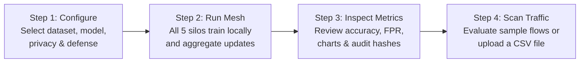

# Qelvari User Guide

- **Live Web Console:** https://aegis-fl-ids.vercel.app
- **Downloadable PDF Guide:** [Qelvari_User_Guide.pdf](../Qelvari_User_Guide.pdf)
- **GitHub Repository:** https://github.com/0xxay/AEGIS-FL

## Overview

Qelvari enables five independent organizations (Bank, Hospital, Enterprise, Government, and Cloud) to train one shared network intrusion detector without sharing raw traffic logs. Each organization trains locally on its private network data and transmits only masked model updates to build the global detector.

## 1. Navigation Bar, Theme Switcher, and 3D Stage

- **Workspace Views (`Overview`, `Flow Scanner`, `Defense Lab`, `Cryptography`, `Architecture`):** Switch instantly between real-time federated training telemetry, live CSV/packet scanning, Byzantine outlier inspection, cryptographic signal paths, and architecture benchmarks.
- **Dark & Light Theme Switcher:** Qelvari opens in Obsidian Dark mode by default and includes a one-click theme toggle in the top-right bar to switch between Dark and Daylight modes (automatically updating charts and 3D lighting).
- **Interactive 3D Consensus Stage:** The 3D cryptographic lattice visualizes the global consensus core and 5 orbiting institutional nodes. Moving your pointer tilts the stage, Compromised silos turn crimson in real time, and clicking **Pause 3D** freezes motion at any time.

| Status Indicator | Meaning |
| :--- | :--- |
| **`5/5 Silos`** | All five institutions (Bank, Hospital, Enterprise, Government, Cloud) have local data partitions loaded. |
| **`SecAgg+ Unmasked`** | Pairwise cryptographic masks protected individual client updates in transit and canceled out in the aggregate sum. |
| **`Opacus RDP (ε=9.53)`** | Cumulative privacy budget (`ε`). Calibrated Gaussian noise prevents single-flow reconstruction; lower `ε` indicates stronger privacy. |
| **`SHA-256 Intact`** | Each round is recorded with a cryptographic hash linked to the previous block, verifying audit log integrity. |

> [!NOTE]
> **Serverless Cold-Start Timing:** After 5 minutes of inactivity, the first click on **Run Federation Experiment** or **Scan Network Flows** takes 5 to 10 seconds while the cloud instance initializes. Subsequent runs complete in 2 to 5 seconds.

## 2. Configuring and Running a Training Experiment

In the **Federation Simulation Workbench** on the `Overview` view (or click **Run Mesh** in the top bar), adjust any parameters across the four columns below and click **`Run Federation Experiment`**.

### Column 1: Dataset & Neural Backbone
- **Benchmark Schema:** Choose `UNSW-NB15` (42 flow features) or `CICIDS2017` (78 flow features).
- **Model Architecture:** `1D ResNet` provides balanced accuracy; `Deep MLP` offers fast baseline training; `8-Token Feature Attention` models cross-feature interactions; `Zero-Day Autoencoder` trains only on benign traffic to detect anomalies.
- **Multi-Class Attribution:** Predicts specific attack categories (such as DoS, Worms, or PortScan) rather than binary Benign vs. Intrusion.
- **Non-IID Skew:** Assigns unbalanced traffic distributions across institutions to reflect heterogeneous network environments.

### Column 2: Privacy & Cryptography
- **Opacus Per-Sample DP-SGD:** Bounds per-sample gradient sensitivity (`Clipping Norm C`) and injects Gaussian noise (`σ`). Increasing `σ` lowers `ε`.
- **Drop-Resilient SecAgg+:** Conceals individual client updates from the server, recovering pairwise masks cleanly if a malicious client is dropped.
- **Energy-Conserving Top-k (5%):** Transmits only the top 5% largest weight updates (zeroing the remaining 95%) to mitigate gradient inversion.
- **Local DP:** Applies randomized label perturbation locally prior to training.
- **Paillier HE:** Uses additive homomorphic encryption to aggregate encrypted output-layer weights.

### Column 3: Adversarial Red-Team
- **None (All 5 Silos Honest):** Standard cooperative training across all 5 institutions.
- **Model Poisoning (Scaling -25x):** Multiplies one compromised client's weight update by `-25` to corrupt global convergence.
- **Stealth Adaptive Norm Poisoning:** Reverses update direction while matching honest update norms to evade basic norm thresholds.
- **Data Poisoning (Label Flip):** Trains the compromised client on inverted labels that mark attack flows as "Benign".
- **Targeted Backdoor Trigger:** Embeds a specific feature trigger inside attack traffic to force targeted misclassifications.
- **Target Compromised Silo:** Selects which of the 5 institutions acts as the adversary.

### Column 4: Byzantine Consensus & Execute
- **Multi-Krum:** Measures pairwise Euclidean distances among client updates and retains the most consistent subset.
- **Norm + Head Sign Guard:** Bounds update norms and blocks updates whose classifier head opposes the global consensus.
- **Cosine Similarity (FLTrust):** Evaluates angular alignment of updates and filters opposing directions.
- **FLAME:** Clusters client updates by angular similarity, removes outliers, and applies adaptive norm clipping.
- **Client Reputation EMA:** Tracks historical client reliability across rounds and down-weights suspicious silos.
- **Median / Trimmed Mean:** Computes coordinate-wise robust statistics so extreme values cannot skew the global model.
- **FedAvg (Unprotected Baseline):** Unprotected weighted averaging, useful when measuring raw attack impact.

## 3. Evaluation Metrics and Live Flow Scanning

| Metric | Definition |
| :--- | :--- |
| **Accuracy** | Percentage of total test flows classified accurately (typically `91% to 92%` on default benchmarks). |
| **Precision** | Proportion of raised intrusion alerts that correspond to actual attacks. |
| **Recall** | Proportion of all actual attacks in the test set detected by the global model. |
| **ROC-AUC** | Threshold-independent separability score from `0.50` (random) to `1.00` (ideal). |
| **False Positive Rate** | Proportion of benign network flows misclassified as intrusions. Lower values indicate fewer false alarms. |
| **Confusion Matrix** | `2×2` breakdown of True Benign (TN), False Alarms (FP), Missed Attacks (FN), and Caught Intrusions (TP). |

### Scanning Network Flows (`Flow Scanner` View)
1. **Sample scan:** Open **Flow Scanner**, choose a **Sample Batch Size** (for example, `60` flows), and click **`Scan Network Flows`**.
2. **Custom CSV upload:** Select any `.csv` file matching UNSW-NB15 or CICIDS2017 columns (up to 4.2 MB) and click **`Scan Network Flows`**.
3. **Filtering & exporting results:** Filter rows by `All Flows`, `Intrusions Only`, or `Benign Only`. Each row lists `BENIGN` or `INTRUSION`, predicted category, visual `Threat Confidence` bar (`0` to `1`), and `Primary Anomaly Signal`. Click **`Export SOC Report (CSV)`** to download `qelvari_soc_scan_report.csv`.

## 4. Example Workflows

1. **Evaluate undefended poisoning impact:** Open the Workbench, set **Attack Vector** to `Model Poisoning (Scaling -25x)`, set **Aggregation Defense** to `FedAvg (Unprotected Baseline)`, and click **Run Federation Experiment**. Global accuracy drops from ~`92%` to ~`40%`.
2. **Isolate a poisoned client automatically:** Keep the attack on `Model Poisoning` (or `Data Poisoning Label Flip`), set **Aggregation Defense** to `FLAME` or `Multi-Krum`, and click **Run Federation Experiment**. Open **Defense Lab** to confirm `Client 3 - Enterprise` is isolated and global accuracy stays above `91%`.
3. **Detect threats without attack labels:** Set Attack back to `None`, select `Zero-Day Autoencoder (MSE)` under Model Architecture, toggle off `Opacus Per-Sample DP-SGD`, and click **Run Federation Experiment**. Training solely on benign flows still flags ~`91%` of intrusions via reconstruction error.
4. **Audit ledger & export SOC report:** Open **Defense Lab** and click **Verify Hash Chain Integrity** to verify all round hashes. Then open **Flow Scanner**, click **Scan Network Flows**, and click **Export SOC Report (CSV)**.
