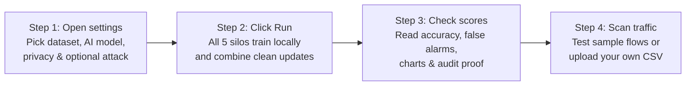

# How to Use AEGIS-FL™ (Plain-English Guide)

- **Live Website:** https://aegis-fl-ids.vercel.app
- **Downloadable PDF Guide:** [AEGIS-FL_User_Guide.pdf](../AEGIS-FL_User_Guide.pdf)
- **GitHub Project:** https://github.com/0xxay/AEGIS-FL

## What problem does this website solve?

Imagine five organizations: a Bank, a Hospital, an Enterprise company, a Government agency, and a Cloud provider. Each one wants an AI alarm system that spots network hackers early. Normally, training one shared AI would mean sending everyone's raw network logs to one central server, which risks leaking private customer or patient records.

AEGIS-FL keeps all raw network traffic inside each building. Each organization trains an AI model on its own private data and sends out only scrambled math updates so everyone gets one stronger intrusion detector with zero raw data shared.

## 1. What the top status badges and 5 tabs do

At the top right of the screen, four colored badges show the live status of the system:

| Badge on screen | What it means in plain words |
| :--- | :--- |
| **`5 Silos Ready`** | All five institutions (Bank, Hospital, Enterprise, Government, Cloud) have their local data ready. |
| **`SecAgg+ Unmasked`** | Secret pairwise masks hid each institution's individual update during transit and canceled out cleanly when summed together. |
| **`Opacus RDP (ε=9.53)`** | Your privacy score (`ε`, pronounced "epsilon"). Careful random noise was added so nobody can rebuild a single network record. A smaller `ε` number means stronger privacy. |
| **`SHA-256 Ledger: Verified`** | Every training round is locked with a digital fingerprint (hash) linked to the round before it, proving past results were not edited. |

> [!TIP]
> **First-click wakeup:** If nobody has visited the site in the last 5 minutes, your first click on **Run Federation Experiment** or **Scan Network Flows Now** takes about 5 to 10 seconds while the cloud server wakes up. Every click after that finishes in 2 to 5 seconds.

### When to use each of the 5 tabs
- **Command Center:** Check overall detection scores, the status of all 5 institutions, round-by-round progress charts, and the confusion matrix.
- **Live Flow Scanner:** Use the trained AI model to scan a sample batch of network traffic or upload your own `.csv` file to flag intrusions.
- **Defense Lab:** See whether a simulated hacker inside one of the institutions got caught, and verify the tamper-evident SHA-256 audit log.
- **Privacy & Crypto:** Read how the five privacy layers work and check all supported attack categories in UNSW-NB15 and CICIDS2017.
- **Research & SOTA:** Compare AEGIS-FL against traditional cloud security tools and open the GitHub repository to contribute or submit ideas.

## 2. How to customize and run a live training experiment

Click the gray bar labeled **`⚙️ Experiment Configuration Panel`** near the top of the page to open the settings drawer. Adjust any options below, then click the yellow **`▶ Run Federation Experiment`** button on the right.

### Column 1: Dataset & Backbone
- **Benchmark Dataset:** Choose between two real-world network security formats: `UNSW-NB15` (42 traffic measurements) or `CICIDS2017` (78 traffic measurements).
- **Neural Architecture (the AI brain):** `1D ResNet` is the strongest all-around choice; `Deep MLP` is fast and simple; `8-Token Feature Attention` compares groups of traffic features against each other; `Zero-Day Autoencoder` learns only what normal traffic looks like and flags anything unusual.
- **Multi-Class Attack Attribution:** Turn on to name the specific attack type (such as DoS, Worms, or PortScan) instead of just Benign vs. Intrusion.
- **Non-IID Skew:** Gives each institution an uneven mix of traffic, matching real life where a bank sees different attacks than a hospital.

### Column 2: Privacy & Cryptography
- **Opacus Per-Sample DP-SGD:** Limits how much any single network flow can change the model (`Clipping Norm C`) and adds random Gaussian noise (`σ`). Raising `σ` strengthens privacy (lowers `ε`).
- **Drop-Resilient SecAgg+:** Masks individual updates so the central server only sees the combined total, even if a bad participant gets kicked out.
- **Energy-Conserving Top-k (5%):** Sends only the top 5% largest weight changes (zeroing out the other 95%) so attackers cannot rebuild private inputs from gradients.
- **Local DP:** Randomly flips a small fraction of training labels inside the institution before training even starts.
- **Paillier HE:** Uses homomorphic encryption so the server can add encrypted output weights without decrypting them first.

### Column 3: Adversarial Attack (Red Team)
- **None (All Honest):** Normal cooperative training across all 5 institutions.
- **Model Poisoning (Scaling -25x):** One compromised institution multiplies its update by `-25` to sabotage the shared model.
- **Stealth Adaptive Norm Poisoning:** The attacker flips its update direction to hurt accuracy while keeping its update size normal so basic size checks miss it.
- **Data Poisoning (Label Flip):** The attacker trains on fake labels that call real cyber attacks "Benign".
- **Targeted Backdoor Trigger:** Hides a secret pattern inside attack traffic so matching attacks slip past the alarm.
- **Compromised Silo:** Picks which of the 5 institutions plays the attacker (its card turns red on the Command Center).

### Column 4: Byzantine Defense (Blue Team)
- **Multi-Krum:** Compares distances between updates and keeps only the tightest group of honest institutions.
- **Norm + Head Sign Guard:** Rejects updates that are unusually large or point the final decision layer backward.
- **Cosine Similarity (FLTrust):** Checks the angle of each update and blocks updates pushing in the opposite direction.
- **FLAME:** Groups similar updates together using clustering, drops outliers, and clips update sizes.
- **Client Reputation EMA:** Remembers how trustworthy each institution was in earlier rounds and lowers weight for suspicious ones.
- **Median / Trimmed Mean:** Takes the middle value or trims extremes so one bad number cannot pull the average.
- **FedAvg (No Defense):** Plain averaging with no protection (useful for seeing how badly an undefended system breaks).

## 3. Understanding your scores and scanning traffic

| Metric | What it tells you in plain words |
| :--- | :--- |
| **Accuracy** | Overall percentage of network connections labeled right (around `91% to 92%` on calibrated benchmarks). |
| **Precision** | When AEGIS-FL raises an alarm, how often it is a real attack. High precision (above `91%`) keeps security teams free of false alarms. |
| **Recall** | Out of all real attacks in the test set, what percentage the model caught. |
| **ROC-AUC** | Separation score from `0.50` (coin flip) to `1.00` (perfect separation). Values above `0.91` show strong separation between benign and malicious traffic. |
| **False Positive Rate** | Percentage of harmless connections mistakenly flagged as attacks. Lower is better. |
| **Confusion Matrix** | A `2×2` table showing exact counts of Benign traffic cleared, Benign traffic falsely flagged, real Intrusions missed, and real Intrusions caught. |

### Scanning network flows in Tab 2 (`Live Flow Scanner`)
1. **Without a file:** Click **Live Flow Scanner**, pick a **Sample Batch Size** (for example, `60` flows), and click **`🔍 Scan Network Flows Now`**.
2. **With your own CSV file:** Choose any `.csv` file with UNSW-NB15 or CICIDS2017 columns (up to 4.2 MB) and click **`🔍 Scan Network Flows Now`**.
3. **Reading each row:** Every connection shows `BENIGN` or `INTRUSION`, the predicted class name, a `Threat Confidence` score between `0` and `1`, and the `Primary Anomaly Signal` (the exact traffic measurement that stood out most, such as packet load `sload`). Click **`⬇ Download SOC Intrusion Report (CSV)`** to save the table.

## 4. Four 1-minute experiments to try right now

1. **Watch a hacker break an undefended system:** Open the settings panel, set **Simulate Attack Vector** to `Model Poisoning (Scaling -25x)`, set **Aggregation Defense** to `FedAvg (No Defense)`, and click **Run**. Accuracy drops from ~`92%` down to ~`40%`.
2. **Block the same hacker automatically:** Keep the attack on `Model Poisoning` (or switch to `Data Poisoning Label Flip`), change **Aggregation Defense** to `FLAME` or `Multi-Krum`, and click **Run**. Open **Defense Lab** to see the rogue silo isolated and global accuracy restored above `91%`.
3. **Catch attacks without using attack labels:** Set Attack back to `None`, pick `Zero-Day Autoencoder (MSE)` under Neural Architecture, uncheck `Opacus Per-Sample DP-SGD`, and click **Run**. Even though it trains only on normal traffic, it catches ~`91%` of intrusions based on abnormal reconstruction error.
4. **Verify the audit chain and export a scan report:** Open **Defense Lab** and click **Verify Hash Chain Integrity** to confirm all round hashes match. Then open **Live Flow Scanner**, click **Scan Network Flows Now**, and click **Download SOC Intrusion Report (CSV)**.
