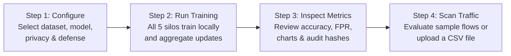

# AEGIS-FL™ User Guide

- **Live Web App:** https://aegis-fl-ids.vercel.app
- **Downloadable PDF Guide:** [AEGIS-FL_User_Guide.pdf](../AEGIS-FL_User_Guide.pdf)
- **GitHub Repository:** https://github.com/0xxay/AEGIS-FL

## Overview

AEGIS-FL enables five independent organizations (Bank, Hospital, Enterprise, Government, and Cloud) to train one shared network intrusion detector without sharing raw traffic logs. Each organization trains locally on its private network data and transmits only masked model updates to build the global detector.

## 1. Status Badges and Navigation Tabs

Four status indicators in the top header summarize the active federation state:

| Status Badge | Meaning |
| :--- | :--- |
| **`5 Silos Ready`** | All five institutions (Bank, Hospital, Enterprise, Government, Cloud) have local data partitions loaded. |
| **`SecAgg+ Unmasked`** | Pairwise cryptographic masks protected individual client updates in transit and canceled out in the aggregate sum. |
| **`Opacus RDP (ε=9.53)`** | Cumulative privacy budget (`ε`). Calibrated Gaussian noise prevents single-flow reconstruction; lower `ε` indicates stronger privacy. |
| **`SHA-256 Ledger: Verified`** | Each round is recorded with a cryptographic hash linked to the previous block, verifying audit log integrity. |

> [!NOTE]
> **Serverless Cold-Start Timing:** After 5 minutes of inactivity, the first click on **Run Federation Experiment** or **Scan Network Flows Now** takes 5 to 10 seconds while the cloud instance initializes. Subsequent runs complete in 2 to 5 seconds.

### Dashboard Tabs
- **Command Center:** View detection metrics, institution status cards, round-by-round training curves, and the confusion matrix.
- **Live Flow Scanner:** Run inference on a sample batch of network flows or upload a custom `.csv` file to classify intrusions.
- **Defense Lab:** Inspect flagged adversarial silos and verify the SHA-256 hash-chained audit ledger.
- **Privacy & Crypto:** Review active privacy mechanisms and supported attack classes for UNSW-NB15 and CICIDS2017.
- **Research & SOTA:** Compare capabilities against centralized IDS approaches and access repository contribution links.

## 2. Configuring and Running a Training Experiment

Click **`⚙️ Experiment Configuration Panel`** near the top of the page to expand the settings drawer. Adjust any parameters below, then click **`▶ Run Federation Experiment`**.

### Column 1: Dataset & Backbone
- **Benchmark Dataset:** Choose `UNSW-NB15` (42 flow features) or `CICIDS2017` (78 flow features).
- **Neural Architecture:** `1D ResNet` provides balanced accuracy; `Deep MLP` offers fast baseline training; `8-Token Feature Attention` models cross-feature interactions; `Zero-Day Autoencoder` trains only on benign traffic to detect anomalies.
- **Multi-Class Attack Attribution:** Predicts specific attack categories (such as DoS, Worms, or PortScan) rather than binary Benign vs. Intrusion.
- **Non-IID Skew:** Assigns unbalanced traffic distributions across institutions to reflect heterogeneous network environments.

### Column 2: Privacy & Cryptography
- **Opacus Per-Sample DP-SGD:** Bounds per-sample gradient sensitivity (`Clipping Norm C`) and injects Gaussian noise (`σ`). Increasing `σ` lowers `ε`.
- **Drop-Resilient SecAgg+:** Conceals individual client updates from the server, recovering pairwise masks cleanly if a malicious client is dropped.
- **Energy-Conserving Top-k (5%):** Transmits only the top 5% largest weight updates (zeroing the remaining 95%) to mitigate gradient inversion.
- **Local DP:** Applies randomized label perturbation locally prior to training.
- **Paillier HE:** Uses additive homomorphic encryption to aggregate encrypted output-layer weights.

### Column 3: Adversarial Attack (Red Team)
- **None (All Honest):** Standard cooperative training across all 5 institutions.
- **Model Poisoning (Scaling -25x):** Multiplies one compromised client's weight update by `-25` to corrupt global convergence.
- **Stealth Adaptive Norm Poisoning:** Reverses update direction while matching honest update norms to evade basic norm thresholds.
- **Data Poisoning (Label Flip):** Trains the compromised client on inverted labels that mark attack flows as "Benign".
- **Targeted Backdoor Trigger:** Embeds a specific feature trigger inside attack traffic to force targeted misclassifications.
- **Compromised Silo:** Selects which of the 5 institutions acts as the adversary.

### Column 4: Byzantine Defense (Blue Team)
- **Multi-Krum:** Measures pairwise Euclidean distances among client updates and retains the most consistent subset.
- **Norm + Head Sign Guard:** Bounds update norms and blocks updates whose classifier head opposes the global consensus.
- **Cosine Similarity (FLTrust):** Evaluates angular alignment of updates and filters opposing directions.
- **FLAME:** Clusters client updates by angular similarity, removes outliers, and applies adaptive norm clipping.
- **Client Reputation EMA:** Tracks historical client reliability across rounds and down-weights suspicious silos.
- **Median / Trimmed Mean:** Computes coordinate-wise robust statistics so extreme values cannot skew the global model.
- **FedAvg (No Defense):** Unprotected weighted averaging, useful as a baseline when measuring attack impact.

## 3. Evaluation Metrics and Live Flow Scanning

| Metric | Definition |
| :--- | :--- |
| **Accuracy** | Percentage of total test flows classified accurately (typically `91% to 92%` on default benchmarks). |
| **Precision** | Proportion of raised intrusion alerts that correspond to actual attacks. |
| **Recall** | Proportion of all actual attacks in the test set detected by the global model. |
| **ROC-AUC** | Threshold-independent separability score from `0.50` (random) to `1.00` (ideal). |
| **False Positive Rate** | Proportion of benign network flows misclassified as intrusions. Lower values indicate fewer false alarms. |
| **Confusion Matrix** | `2×2` breakdown of True Negatives, False Positives, False Negatives, and True Positives. |

### Scanning Network Flows in Tab 2 (`Live Flow Scanner`)
1. **Sample scan:** Open **Live Flow Scanner**, choose a **Sample Batch Size** (for example, `60` flows), and click **`🔍 Scan Network Flows Now`**.
2. **Custom CSV upload:** Select any `.csv` file matching UNSW-NB15 or CICIDS2017 columns (up to 4.2 MB) and click **`🔍 Scan Network Flows Now`**.
3. **Reviewing & exporting results:** Each row lists `BENIGN` or `INTRUSION`, predicted category, `Threat Confidence` (`0` to `1`), and `Primary Anomaly Signal` (the top contributing flow feature, such as `sload`). Click **`⬇ Download SOC Intrusion Report (CSV)`** to export.

## 4. Example Workflows

1. **Evaluate undefended poisoning impact:** Open the configuration panel, set **Simulate Attack Vector** to `Model Poisoning (Scaling -25x)`, set **Aggregation Defense** to `FedAvg (No Defense)`, and click **Run**. Global accuracy drops from ~`92%` to ~`40%`.
2. **Isolate a poisoned client automatically:** Keep the attack on `Model Poisoning` (or switch to `Data Poisoning Label Flip`), set **Aggregation Defense** to `FLAME` or `Multi-Krum`, and click **Run**. Open **Defense Lab** to confirm the compromised silo is rejected and global accuracy stays above `91%`.
3. **Detect threats without attack labels:** Set Attack back to `None`, select `Zero-Day Autoencoder (MSE)` under Neural Architecture, uncheck `Opacus Per-Sample DP-SGD`, and click **Run**. Training solely on benign flows still flags ~`91%` of intrusions via reconstruction error.
4. **Audit ledger & export SOC report:** Open **Defense Lab** and click **Verify Hash Chain Integrity** to verify all round hashes. Then open **Live Flow Scanner**, click **Scan Network Flows Now**, and click **Download SOC Intrusion Report (CSV)**.
